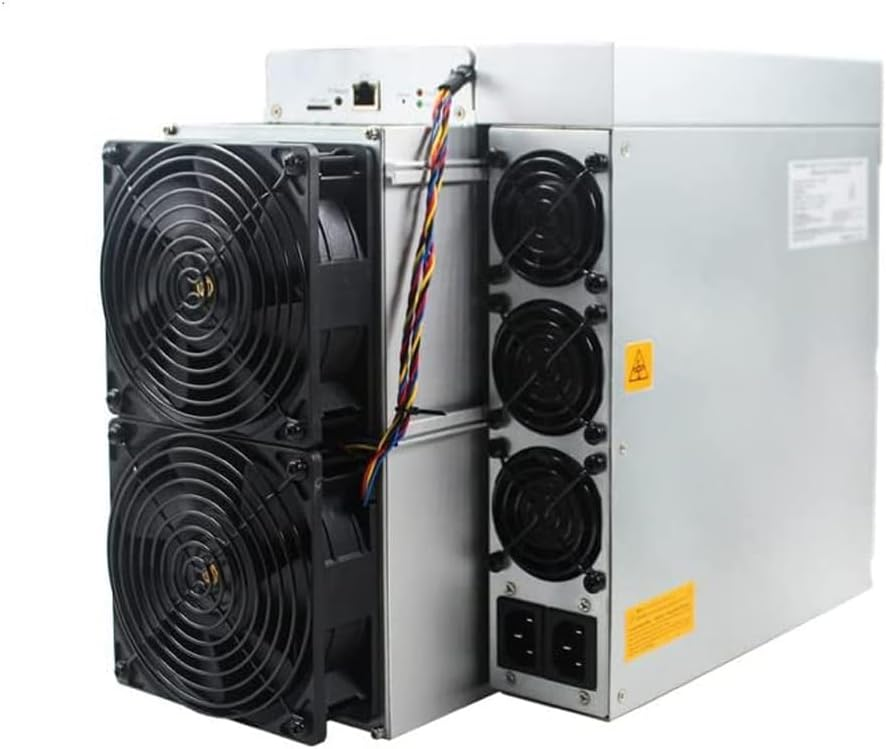
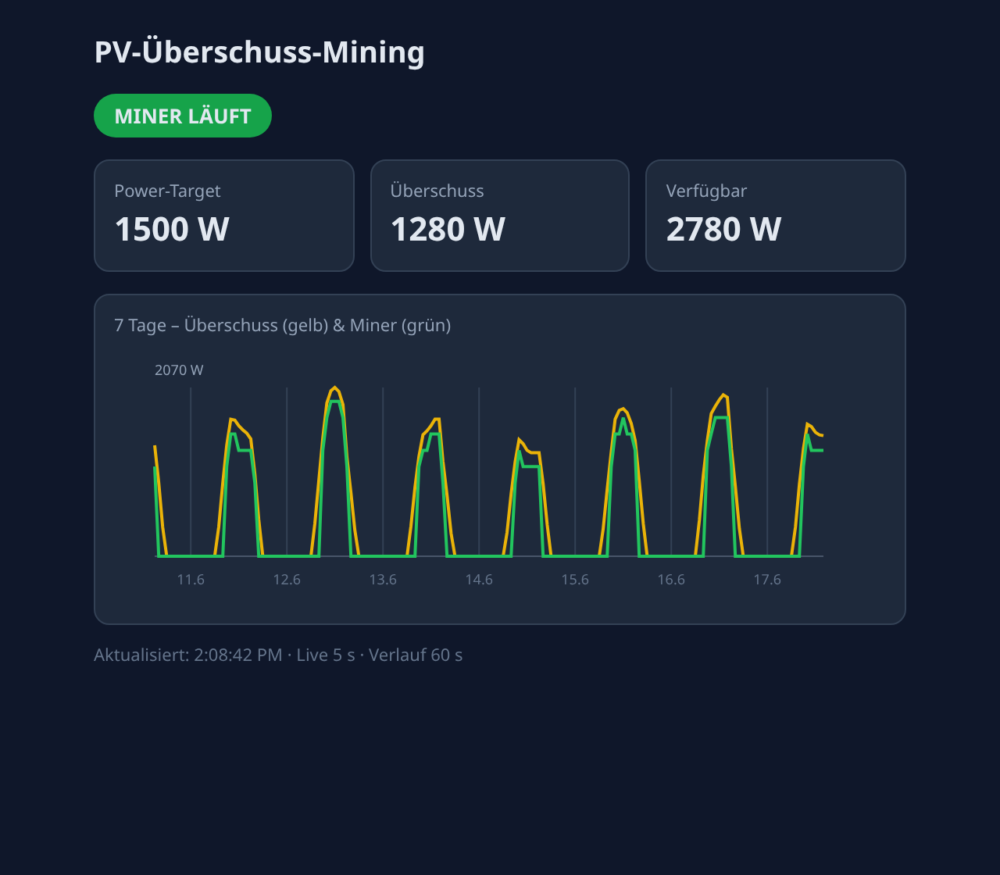
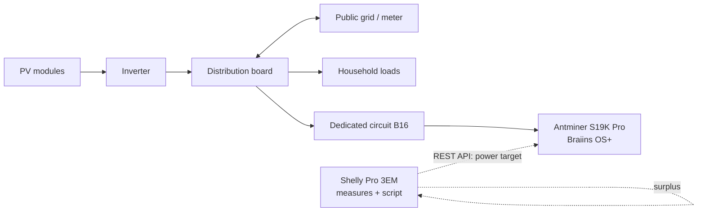
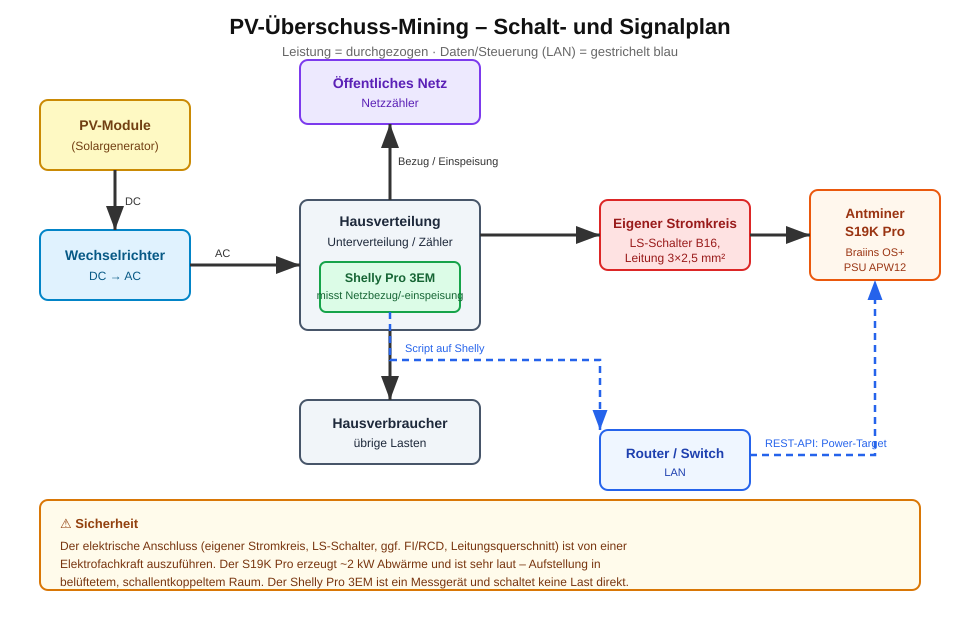

# PV Bitcoin Miner

[🇩🇪 Deutsch](README.md) · 🇬🇧 English

> 💡 **PC variant with a GPU:** If you don't want to buy an ASIC, the [`gpu/`](gpu/) folder has an alternative based on an NVIDIA RTX 3070 (NiceHash/Autolykos2, PV-controlled via the same Shelly Pro 3EM).

<br>
<a href="https://www.buymeacoffee.com/thoralf.brandt" target="_blank">
  
</a>
<br>



Use surplus electricity from a PV system for **Bitcoin mining** instead of feeding it into the grid – the miner automatically adjusts its power to the PV surplus currently available. Everything is controlled **directly by the Shelly Pro 3EM** via a script; no additional computer needed.


The Shelly hosts a web page with this chart

> ⚠️ **Disclaimer.** This project is for information purposes only. It is **not** financial, tax or electrical advice. The electrical connection must be made by a qualified electrician. Mining income is volatile and taxable in Germany. Use at your own risk.

---

## How it works

The Shelly Pro 3EM sits at the **grid meter** and measures the balance of household consumption and PV generation. A negative value (`total_act_power < 0`) means feed-in, i.e. surplus. The script on the Shelly calculates the available power from this and sets a matching power target on the miner via the **Braiins OS+ REST API** – or pauses it if there isn't enough surplus.



Full wiring and signal diagram:



---

## Parts list

| Component | Recommendation | Note |
|---|---|---|
| Energy measurement | **Shelly Pro 3EM** | at the grid meter, 3-phase |
| Miner | **Antminer S19K Pro** (used) | ~120 TH/s, ~2,760 W stock |
| Firmware | **Braiins OS+** | power target & REST API |
| Circuit | B16 circuit breaker, 3×2.5 mm² cable | by a qualified electrician |
| Network | LAN cable Shelly ↔ router ↔ miner | stable connection |
| Placement | ventilated, sound-insulated room | ~2 kW waste heat, very loud |

---

## Miner overview & comparison

For PV surplus, **efficiency** (J/TH) matters most: the fewer watts per terahash, the more hashrate – and therefore Bitcoin – per kilowatt-hour of surplus.

| Model | Hashrate | Stock power | Efficiency | Control range (Braiins OS+) | Used* | Noise |
|---|---|---|---|---|---|---|
| Antminer S9 | ~13.5 TH/s | ~1,350 W | ~100 J/TH | ~250–1,400 W | ~€80–130 | very loud |
| Antminer S17e | ~50–64 TH/s | ~2,500 W | ~45 J/TH | ~1,000–2,500 W | ~€150–300 | very loud |
| Antminer S19 Pro | ~110 TH/s | ~3,250 W | ~30–34 J/TH | ~1,500–3,250 W | ~€400–800 | very loud |
| Antminer S19j Pro | ~100 TH/s | ~3,050 W | ~30 J/TH | ~1,500–3,000 W | ~€400–700 | very loud |
| **Antminer S19K Pro** | **~120 TH/s** | **~2,760 W** | **~23 J/TH** | **~900–2,760 W** | **~€600–900** | very loud |

\*Rough figures from German classifieds/eBay, fluctuating strongly.

### Hashrate with a limited 2,000 W surplus (throttled)

| Model @ ~2,000 W | approx. hashrate | rel. yield |
|---|---|---|
| S9 (max. ~1,350 W) | ~13–14 TH/s | 1× |
| S17e | ~40–45 TH/s | ~3× |
| S19(j) Pro | ~60–70 TH/s | ~5× |
| S19K Pro | ~80–85 TH/s | ~6× |

---

## Why the S19K Pro

- **Best efficiency** of the selection (~23 J/TH) → gets the most out of 2,000 W.
- **Smoothly adjustable** via Braiins OS+: power target **continuously from 900 to 2,760 W**. The autotuner automatically sets voltage/clock to the given watt target.
- The REST API allows control **directly from the Shelly** without an extra computer.

**Important limitation:** The S19K Pro does **not go below ~900 W**. If the surplus drops below that (clouds, early morning/evening), the miner has to **pause completely** instead of continuing at low power. In very changeable weather an S9 (lower limit ~250 W) runs more hours; with a stable, high midday surplus the S19K Pro plays to its efficiency. That's why the script uses **hysteresis** (ON from 1,050 W, OFF below 850 W).

---

## Economics & payback

**Assumptions** (as of mid-June 2026 – please update yourself):

- Hashprice ≈ **$0.031 / TH/s / day** (≈ €0.029, rate 1.08)
- BTC ≈ $64,000
- Annual PV surplus ≈ **3,000 kWh** ← **biggest lever, adapt to your own system**
- Electricity cost = €0 (otherwise unused surplus)

### Yield per kWh of surplus

| Miner | Efficiency | Yield/kWh |
|---|---|---|
| S9 | ~100 J/TH | ~€0.012 |
| S17e | ~45 J/TH | ~€0.027 |
| S19 Pro | ~32 J/TH | ~€0.037 |
| S19j Pro | ~30 J/TH | ~€0.040 |
| S19K Pro | ~23 J/TH | ~€0.052 |

### Cost, annual yield, payback

| Miner | Hardware | usable kWh/year | Yield/year | Payback |
|---|---|---|---|---|
| S9 | ~€100 | ~2,400 | ~€29 | ~3.4 years |
| S17e | ~€220 | ~3,000 | ~€80 | ~2.7 years |
| S19 Pro | ~€600 | ~3,000 | ~€112 | ~5.4 years |
| S19j Pro | ~€550 | ~3,000 | ~€120 | ~4.6 years |
| S19K Pro | ~€750 | ~3,000 | ~€156 | ~4.8 years |

### Reality check (honestly)

1. **The feed-in tariff often beats mining.** With a feed-in tariff of ~7–8 ct/kWh, feeding in is financially better than any miner yield per kWh (1.2–5.2 ct). Purely financially, mining only pays off if the alternative is "give it away/curtail" – or if you deliberately want to accumulate BTC (betting on the price).
2. **Difficulty rises.** Yield per TH/s has historically fallen over time → real payback tends to be longer.
3. **Wear.** Used hardware can fail before it pays for itself (especially an old S9).
4. **Self-consumption beats everything.** Using surplus for hot water/battery saves ~30 ct/kWh – far more valuable than mining.

---

## Setup

### 1. Braiins OS+ on the miner
- Install the firmware (see [braiins.com/os](https://braiins.com/os)).
- Make sure the **public REST API** is available (port 80, `/api/v1`). API docs: [developer.braiins-os.com](https://developer.braiins-os.com/latest/openapi.html).
- Note the miner's username/password (locally, **not** in the repo).

### 2. Shelly Pro 3EM
- Check the sign: with definite feed-in, `EM.GetStatus` must show a **negative** `total_act_power`.
  Call in the browser: `http://<shelly-ip>/rpc/EM.GetStatus?id=0`

### 3. Install the script
- Shelly web UI → **Scripts** → **Add Script** → paste the contents of [`pv-miner-control.js`](pv-miner-control.js).
- In the `CONFIG` block, enter `minerIp`, `minerUser`, `minerPass` **locally**.
- Save, **Start**, and **enable "Run on startup"** in the script options (otherwise the control won't start by itself after a power cut).
- Watch the logs.

### Configurable parameters (excerpt)

| Parameter | Default | Meaning |
|---|---|---|
| `powerLevels` | `900…1900` | usable power levels (W) |
| `puffer` | `100` | safety margin to grid feed-in (W) |
| `onThreshold` | `1050` | surplus to switch on (W) |
| `offThreshold` | `850` | surplus to switch off (W) |
| `intervalSec` | `30` | check interval (s) |

### 4. Open the dashboard

The script serves a status page **directly from the Shelly** – no extra device needed. After starting, it's available on the home network at:

```
http://<shelly-ip>/script/<script-id>/ui
```

The `<script-id>` is the number shown in the Shelly UI under "Scripts" (e.g. `1`). The page shows miner status (ON/OFF), the current power target, surplus, available power **and a 7-day history** (surplus in yellow, miner power in green) – just like in the chart above. Live values refresh every 5 s, the history every 60 s. The chart is pure inline SVG (no external library, so it also works without internet). All data comes from the Shelly's own address (same origin → no CORS problems). **The dashboard does not work via GitHub Pages** (an HTTPS page may not query local `http://` addresses) – it only runs on the home network.

> The dashboard labels are in German.

Three endpoints are available (the JSON endpoints send `Access-Control-Allow-Origin: *`, e.g. for logging in Home Assistant):

| Endpoint | Content |
|---|---|
| `…/ui` | HTML dashboard with chart |
| `…/data` | Live JSON: status, power target, surplus |
| `…/history` | 7-day history as JSON (hourly averages) |

**7-day history – deliberately adapted to the Shelly's limits:** The persistent storage (KVS) allows max. 253 characters per value and 50 keys, and RAM is tight. Fine second/minute resolution over 7 days is therefore not possible. The script stores **hourly averages** (168 points) and saves them once an hour in 7 KVS blocks (each < 253 characters) – so the history survives a restart. Downtime shows up as gaps in the chart. For finer or longer history, a small always-on device (Pi/Home Assistant) that logs the `…/history` endpoint is a good addition later.

---

## Security & privacy

- **Don't commit private data:** enter IP addresses and credentials only locally. See [`.gitignore`](.gitignore).
- **Electrics:** dedicated circuit, correct protection (B16 breaker), cable cross-section and RCD by a **qualified electrician**.
- **Heat/noise:** ~2 kW waste heat, ~75 dB+ – only operate in a suitable room.
- The Shelly Pro 3EM is a **measuring device** and does not switch any load directly; control runs via the miner API.

---

## Project structure

```
pv-bitcoin-miner/
├── README.md                       German start page
├── README_EN.md                    This page
├── LICENSE                         MIT license
├── .gitignore                      keeps local config/credentials out of Git
├── Antminer-S19K-Pro.jpg           Title image
├── pv-miner-dashboard-grafik.png   Dashboard preview
├── pv-miner-control.js             Control script + dashboard for the Shelly Pro 3EM
├── schaltplan.svg                  Wiring and signal diagram
└── .github/
    └── FUNDING.yml                 Sponsoring links
```

---

## License

MIT – see [`LICENSE`](LICENSE). Sources for API/specifications: Braiins (OS+ REST API), Shelly (Gen2 scripting/EM component). Figures are snapshots and without guarantee.
